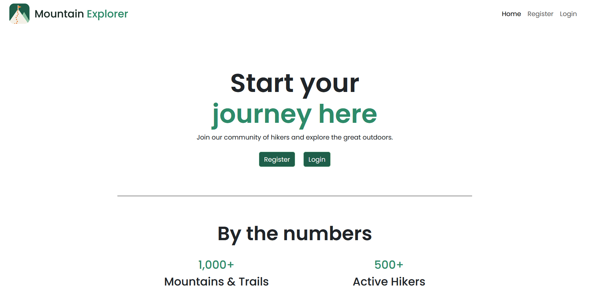
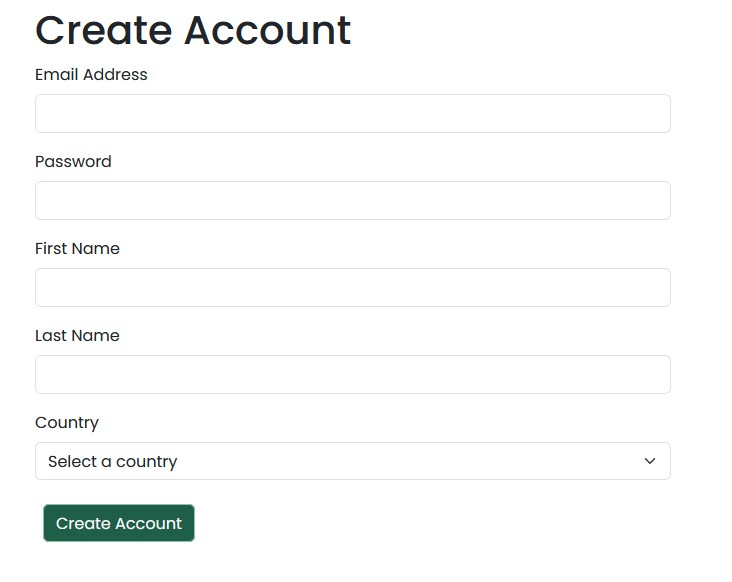
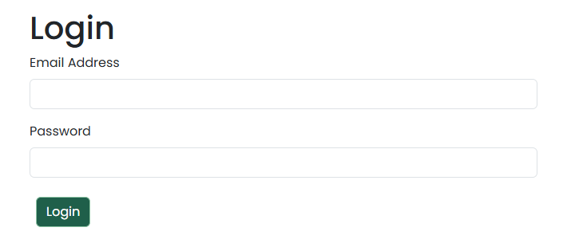
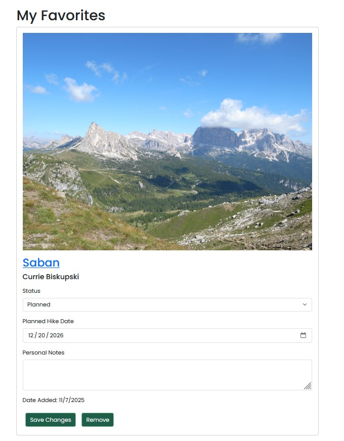
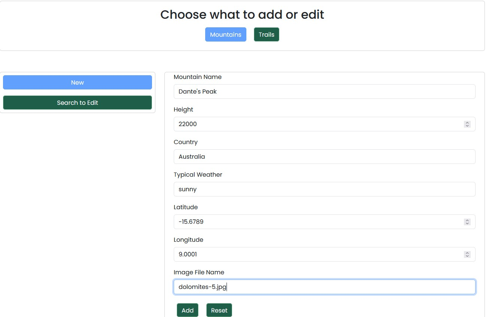
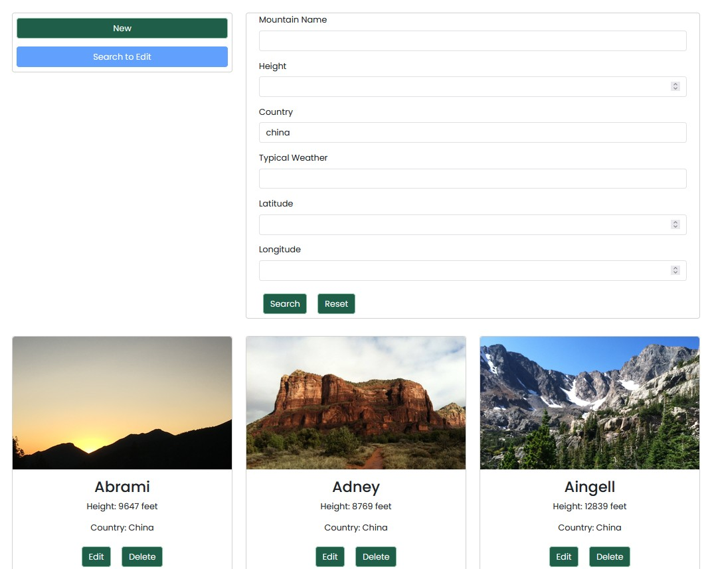

# Mountain Explorer

Mountain Explorer is a full-stack hiking management and planning web application that allows users to create and manage an account, search for mountains and trails, and maintain a personalized list of favorite trails.

The application also provides administrative functionality for managing mountain and trail information.

## Authors

- [Joseph Sikowitz](https://joseph-sikowitz.github.io/homepage/)
- [Thai Ken Yong](https://yongt22.github.io/P1-MyHomepage/)

## Course

**CS5610 Web Development**  
Northeastern University

**Class Link:**  
https://johnguerra.co/classes/webDevelopment_online_fall_2026/

## Public Deployment

Mountain Explorer is deployed using Render.

**Live Application:**  
https://mountain-explorer-4e5n.onrender.com/

## Design Document

The Mountain Explorer design document contains the project description, user personas, user stories, technology information and design mockups.

**Design Document:**  
[`docs/Project-2-Mountain-Explorer-Design-Document-Yong-Sikowitz.pdf`](docs/Project-2-Mountain-Explorer-Design-Document-Yong-Sikowitz.pdf)

## Demo and Presentation Video

A narrated demonstration of the Mountain Explorer application and presentation is available here:

[Mountain Explorer Demo](https://youtu.be/1_1kWCQPN5Y)

[Mountain Explorer Presentation](https://youtu.be/BpYcY2PZ-E4)

## Presentation Slides

Presentation slides for the project:

https://docs.google.com/presentation/d/1f3dIf2w4Eunbpu5ebpOVg8JYpeDC5tu-UCW_l1zzDm4/edit?usp=sharing

## Project Objective

The objective of Mountain Explorer is to build a full-stack web application using HTML5, CSS3, Vanilla JavaScript ES6+, Node.js, Express and MongoDB.

The project demonstrates client-side rendering, REST API development, MongoDB CRUD operations and integration between the frontend, backend and database.

The application supports both regular users and administrators. Regular users can create and manage their accounts, search for mountains and trails and maintain favorite trails. Administrators can manage mountain and trail information.

## Features

### User Features

- Create a user account
- Log in to an existing account
- View user profile information
- Update account password
- Delete a user account
- Search for mountains by name or country
- View mountain information
- View trails associated with a mountain
- Add trails to favorites
- View saved favorite trails
- Update favorite trail status
- Update planned hike date
- Add or update personal notes
- Remove trails from favorites

### Administrator Features

- Administrator login
- Search and view mountain information
- Create mountain records
- Update mountain records
- Delete mountain records
- Search and view trail information
- Create trail records
- Update trail records
- Delete trail records

## Accessing and Using the Administrative Interface

1. On the homepage, scroll down to the bottom of the page until you see "Admin Login" on the right side of the footer.

2. Click the "Admin Login" link.

3. Use the following sample credentials to access the Administrative Interface:

```text
Username: admin@me.com
Password: admin
```

4. Execute CRUD operations for mountains and trails using the Admin Panel.

## Accessing and Using the User Interface (KEN)

1. On the homepage, click "Register" to create a new user account.

2. After creating an account, log in using the email and password you registered.

3. Once logged in, users can access the following features:
   - Update their password and delete their account.
   - Add, view, update, and remove favorite trails.
   - Update hiking status, planned hike date and personal notes.

## Technologies Used

| Technology | Purpose |
| --- | --- |
| HTML5 | Provides the semantic structure and forms for the application |
| CSS3 | Provides custom styling and page layout |
| Bootstrap 5 | Provides responsive layout, components, and utility classes |
| JavaScript ES6+ | Provides client-side logic, DOM manipulation, and API communication |
| Node.js | Provides the server-side JavaScript runtime |
| Express | Provides REST API routes and the web server |
| MongoDB | Stores application data |
| MongoDB Native Node.js Driver | Connects the Node.js backend to MongoDB and performs database operations |
| dotenv | Loads environment variables used for application configuration |
| Render | Deploys and hosts the Node.js/Express application on a public web server |
| ESLint | Checks JavaScript code quality |
| Prettier | Provides consistent code formatting |
| Git & GitHub | Provides version control and team collaboration |
| https://www.mockaroo.com/ | Generate realistic sample data for testing |
| Render | Hosts and deploys the web application to make it publicly accessible online |

## Database

Mountain Explorer uses MongoDB and contains the following primary collections:

- `users` - Stores user account information
- `favorites` - Stores trails saved by users and their hiking plans
- `mountains` - Stores mountain information
- `trails` - Stores trail information associated with mountains

CRUD operations for each collection are enabled by the following routes:

- `users.js` (Ken)
- `favorites.js` (Ken)
- `mountains.js` (Joseph)
- `trails.js` (Joseph)

The Render deployed version of that app has at least 1,000 records in each collection. To check mountain and trail counts via the API, use the following endpoints:

- [https://mountain-explorer-4e5n.onrender.com/api/mountains/count]
- [https://mountain-explorer-4e5n.onrender.com/api/trails/count]

## Limitations

Mountain Explorer was created with the following limitations recognized as out of scope:

- API security
- Password hashing
- Password recovery

## Screenshots



### User Interface







### Administrator Interface





## Installation and Setup

### Prerequisites

Before running Mountain Explorer locally, make sure the following are installed:

- Node.js
- npm
- Access to a MongoDB database

### 1. Clone the Repository

```bash
git clone https://github.com/joseph-sikowitz/mountain-explorer.git
```

### 2. Enter the Project Directory

```bash
cd mountain-explorer
```

### 3. Install Dependencies

```bash
npm install
```

### 4. Configure Environment Variables

Create a `.env` file in the root directory.

The application requires the following environment variables:

```text
MONGODB_URI=YOUR_MONGODB_CONNECTION_STRING
MONGODB_NAME=hiking_app
MONGODB_COLLECTION_MOUNTAINS=mountains
MONGODB_COLLECTION_TRAILS=trails
```

### 5. Start the Application

```bash
node app.js
```

The application will run locally using the port configured by the application.

Open the local application in a web browser.

[PLACEHOLDER - Verify the local URL/port used for development, for example `http://localhost:3000`.]

## Generative AI Usage

- **Claude Sonnet 5.5** was used to create a logo and favicon for the app using the following prompt.

 > Create me a logo and favicon for a web app that allows hikers to organize mountains and trails to track what they've hiked and what they want to hike. The name of the app is Mountain Explorer.

- **GPT-6 Luna** was used to review the project and help create this README.

 > Review the whole Mountain Explorer project and help me update the README.md. This README is for both Joseph Sikowitz and Thai Ken Yong, so include both the user and admin sides. Make sure it includes the authors, project objective, main features, technologies used, screenshots, setup instructions, deployment, design document, demo video and license. Please check the actual code so you don't list features we don't have. If information such as a URL or screenshot is missing, just put a placeholder instead of making it up. Show me the README first before changing the file.


## License

This project is licensed under the MIT License. See the [LICENSE](LICENSE) file for details.